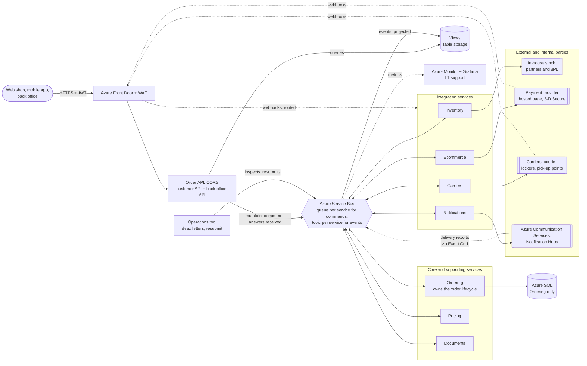

# Order Processing Platform

A .NET 10 **solution skeleton** for an order processing platform on Azure: the structure, the service
boundaries, the contracts, the decisions with their reasons, and one vertical slice that runs. It is
the starting point for a delivery team, not a finished application.

## The design in one minute

- **Seven services**, each with its own Azure app, data, identity and pipeline. Core: **Ordering** and
  **Pricing**. Supporting: **Documents** (files). Integration services in front of external and
  internal parties: **Inventory**, **Ecommerce** (`ecommerce-integration-service`), **Carriers** and
  **Notifications**.
- **One CQRS Order API in front**, in GraphQL, deployed twice: a customer API (web shop, mobile app) and
  a back-office API (staff). Mutations queue a command and answer "received"; queries read views built
  from events. Front ends call only the Order API.
- **Service Bus only between services.** A request is a command on the service's queue, the answer is an
  event on its topic. No outbox: the trigger redelivers a message until its handler has saved and published.
- **One function per feature**, clean architecture inside each service.
- **Received at once, accepted after checks.** `placeOrder` answers `Submitted`; price and stock follow
  by message, then the order is `Pending` (accepted) or `Rejected`. Payment and shipping follow, with a
  compensation for every failure.
- **The `Order` aggregate owns the status**: `Submitted → Pending → Confirmed → Shipped → Delivered`,
  ending otherwise in `Cancelled` or `Rejected`. Every transition is recorded and published.
- **Azure**: Functions apps on Windows App Service plans grouped by demand, Azure SQL for Ordering,
  Table storage per integration service, Blob storage with short-lived SAS links, Terraform.
- **The skeleton** runs all services in one local process with in-memory infrastructure. Its modules map
  one to one onto the services, and tests on the compiled assemblies enforce the boundaries.

## The platform on one page



HTTP is used only by the front ends (to the Order API), by provider webhooks, and by integration
services calling their parties.

## Where to look

| For | Read |
|-----|------|
| Scope, assumptions, services and rules between them | [01 Overview](docs/architecture/01-overview.md) |
| The order flow and every failure path | [02 Order lifecycle](docs/architecture/02-order-lifecycle.md) |
| Non-functional requirements, targets, trade-offs | [03 Quality attributes](docs/architecture/03-quality-attributes.md) |
| What is real, what is a placeholder, build order | [04 Implementation guide](docs/architecture/04-implementation-guide.md) |
| Azure hosting | [05 Azure reference architecture](docs/architecture/05-azure-reference-architecture.md) |
| Payments, inventory sources, carriers, notifications | [06 Integration services](docs/architecture/06-integration-services.md) |
| GDPR, PSD2 (3-D Secure), PCI DSS | [07 Data protection](docs/architecture/07-data-protection-and-compliance.md) |
| What each service stores | [08 Data model](docs/architecture/08-data-model.md) |
| Why each decision was made | [Decision records](docs/adr/README.md), starting with ADR-0001 |
| GraphQL schemas, webhooks, events | [API and contracts](docs/api/README.md) |
| Effort and Azure costs | [Estimation](docs/estimation/README.md) |
| Terms | [Glossary](docs/glossary.md) |
| How AI was used | [AI usage](docs/ai-usage.md) |

Three files carry most of the design in code:
[Order.cs](src/Modules/Ordering/OrderProcessing.Ordering.Domain/Order.cs) (the lifecycle rules),
[PlaceOrder.cs](src/Modules/Ordering/OrderProcessing.Ordering.Application/PlaceOrder.cs) (receiving an
order idempotently) and
[OrderFulfillmentProcess.cs](src/Modules/Ordering/OrderProcessing.Ordering.Application/OrderFulfillmentProcess.cs)
(the whole flow by message, with its compensations).

## Requirements coverage

| Requirement | Where |
|-------------|-------|
| Create an order with one or more products | `placeOrder` → `PlaceOrder` command → `PlaceOrderHandler` → `Order.Submit` |
| Retrieve an order | `order` query → order view |
| Cancel when permitted | `cancelOrder` → `CancelOrder` command → `Order.Cancel` (allowed until shipped) |
| Track the lifecycle | `Order.History`; one event per transition; the `tracking` timeline on the `order` query |
| Validate inventory before accepting | Only `StockReserved` moves `Submitted` to `Pending`; `StockReservationFailed` ends in `Rejected` ([ADR-0005](docs/adr/0005-order-placement-flow.md)) |
| Pricing with taxes and charges | `IPricingRule` pipeline: `ShippingChargeRule`, `DestinationTaxRule` |
| External inventory, payment, shipping | One integration service each: contract, provider port, replaceable adapter |
| Non-functional requirements | [03 Quality attributes](docs/architecture/03-quality-attributes.md) |

What the brief requires and what was added is in
[the scope table](docs/architecture/01-overview.md#scope-what-the-brief-requires-and-what-was-added).

## Run it

```bash
dotnet build && dotnet test
dotnet run --project src/Host/OrderProcessing.Host        # http://localhost:5080
```

## Not in the skeleton

- Durable stores, the Service Bus transport and one Functions host per service: in memory and one local
  host here ([ADR-0001](docs/adr/0001-microservices-and-function-per-feature.md), [ADR-0004](docs/adr/0004-data-ownership-and-storage.md), [ADR-0009](docs/adr/0009-azure-hosting.md)).
- The Documents service: designed in [ADR-0004](docs/adr/0004-data-ownership-and-storage.md).
- Real provider adapters: fakes behind the real ports ([ADR-0006](docs/adr/0006-external-integrations.md)).
- Returns, partial shipments and order amendments: out of scope ([assumptions](docs/architecture/01-overview.md#assumptions)).

The build order is in the [implementation guide](docs/architecture/04-implementation-guide.md#suggested-build-order).
