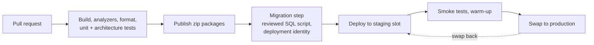

# Deploy

Every service runs as Azure Functions apps on Windows App Service plans grouped by demand, with Service
Bus between them, Azure SQL for Ordering and Azure Storage for the rest
([05 Azure reference architecture](../docs/architecture/05-azure-reference-architecture.md),
[ADR-0009](../docs/adr/0009-azure-hosting.md), [ADR-0011](../docs/adr/0011-deployment.md)).

| File | Purpose | State |
|------|---------|-------|
| [docker-compose.yml](docker-compose.yml) | Local dependencies: telemetry viewer; SQL Server and the storage emulator behind a profile | Not run yet |
| [terraform/](terraform/README.md) | The shared platform and the Ordering service end to end, for test and production | Validated, tested and scanned; not applied to a subscription |
| [release-ordering.yml](../.github/workflows/release-ordering.yml) | Release of one service: build once, staging slot, swap | Template for the other services |

CI builds, tests, checks formatting and publishes the deployable package.

## Release flow

## Configuration

Environment-specific values are app settings (`__` maps to `:`). Secrets are Key Vault references;
connections to Azure resources use the app's managed identity.

| Setting | Example | Secret |
|---------|---------|:------:|
| `Authentication__Schemes__Bearer__Authority` | `https://<tenant>.ciamlogin.com/<tenant-id>/v2.0` | |
| `Authentication__Schemes__Bearer__ValidAudiences__0` | `api://order-processing` | |
| `APPLICATIONINSIGHTS_CONNECTION_STRING` | | |
| `ConnectionStrings__Ordering` | `Server=<server>.database.windows.net;Database=orders;Authentication=Active Directory Default` | |
| `ServiceBus__FullyQualifiedNamespace` | `<namespace>.servicebus.windows.net` | |
| `Storage__BlobServiceUri`, `Storage__TableServiceUri` | `https://<account>.blob.core.windows.net` | |
| `Carriers__WebhookSecret` | Key Vault reference | yes |
| `Pricing__TaxRates__GR` | `0.24` | |

The Terraform and release pipelines of the other services follow the Ordering ones; they are packages
in the [build order](../docs/architecture/04-implementation-guide.md#suggested-build-order).
