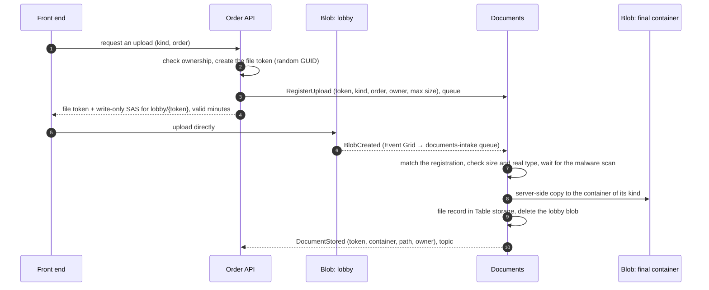

# ADR-0004: Data owned per service: Azure SQL, Table storage and Blob storage

- Date: 2026-11-13

## Context

Services must own their data, or their independence
([ADR-0001](0001-microservices-and-function-per-feature.md)) is fiction. The data needs are not uniform:

- **Ordering** needs relational, transactional storage: an order, its lines, its history and its
  inbox must commit together.
- Each **integration service** needs to remember small, keyed facts: which provider reference belongs to
  which order, which message it has already processed, what the last tracking status was.
- The platform must store and hand out **files**: invoices, shipping labels, proof-of-delivery photos.

The platform uses Azure SQL Database with controlled SQL execution, Azure Table storage
for each service's own data, and Azure Storage with secured SAS links for files and photos.

## Decision

### 1. Ownership rules, for every service

- **A service's data is private.** No other service reads or writes it. A service that needs another's
  data asks through the contract or keeps its own copy from events. Others are referenced by id only.
- **No shared tables, no cross-service joins or foreign keys.**
- **One aggregate per transaction.** The `Order` aggregate is loaded and saved whole.
- **Optimistic concurrency** on `Order.Version`, because an order is updated by concurrent actors
  (the customer cancelling, a payment event, a carrier webhook). A conflicting message handler is
  retried; the API never writes an order itself, so it has no conflict to report.
- **Idempotency** for order placement is a unique index on `(customer_id, idempotency_key)`.
- **Schema changes are backward compatible** (expand, then contract) and run as a separate deployment
  step ([ADR-0011](0011-deployment.md)), so old and new versions can run side by side during a rollout.

### 2. Azure SQL Database for Ordering, with controlled execution

Ordering uses **Azure SQL Database** with EF Core, in its own schema (`ordering`). Another service that
comes to need relational data gets its own schema and database user, or its own database, never shared tables.

"Controlled" means the database only ever runs SQL that was reviewed and deployed:

- **No ad hoc SQL from the application.** Access goes through EF Core with parameterised queries, or
  through stored procedures for operations that must be set-based or tightly permissioned. String-built
  SQL is rejected in review and by an analyzer.
- **Each app connects with its own managed identity**, mapped to a database user that can read and
  write only its service's schema. No passwords, no shared login, no `db_owner`, no DDL rights at runtime.
- **Schema changes only through the pipeline.** Migrations are generated, reviewed as SQL scripts in the
  pull request, and executed by a separate deployment identity. Nobody alters production by hand.
- **Human access is exceptional**: read-only by default, write access just-in-time, through Entra,
  and audited.
- **Auditing and Query Store are on**, so every statement and its cost can be traced.

The inbox table (message ids already handled) lives in the same database, so an order change and the
record of the message that caused it commit together. There is no outbox table ([ADR-0012](0012-reliable-messaging-without-an-outbox.md)).

### 3. Azure Table storage for each integration service

Every integration service owns its tables in Azure Table storage, and nothing else reads them.

| Used for | Shape |
|----------|-------|
| Provider references (payment id, shipment id, reservation id) | PartitionKey = order id |
| Inbox: messages already processed, for idempotency | PartitionKey = order id, RowKey = message id |
| Webhook receipts and last known status | PartitionKey = order id |

Keying everything by order id matters: Table storage commits a batch atomically **within one
partition**, so "record the provider's answer, mark the message processed" is one
atomic write for an order.

### 4. Files: one upload lobby, a file token, read links signed by the Order API

All files (images, PDFs, logos, labels, delivery photos, invoices) live in **private** blob containers.
Nothing is publicly readable and storage account keys are disabled. The **Documents** service is the
only writer of the final containers and of the file records, and owns retention and erasure.

**Every file enters through one container: the file lobby.**

1. **The file token is a random GUID (version 4).** It is the only name a front end ever sees, it is
   created when the upload is requested, and it is also the blob name in the lobby (`lobby/{token}`).
   It says nothing about the container, the path or the order, so containers can be reorganised
   without changing any client.
2. **Nobody uploads without a registration.** Whoever issues the write link (the Order API for
   clients) or writes to the lobby (an internal service with its managed identity, which may write to
   the lobby and nowhere else) first sends `RegisterUpload` to Documents with the token, the kind of
   file, the order, the owner and the size limit. A blob in the lobby without a matching registration
   is deleted. The client cannot choose where its file ends up or whose order it belongs to.
3. **Documents moves a file out of the lobby only when it is clean.** The `OnFileArrived` function,
   triggered by Event Grid through the `documents-intake` queue, checks the size, checks the type from
   the content of the file and not from its name, waits for the result of the on-upload malware scan
   (Microsoft Defender for Storage), copies the blob to the container of its kind (`images`,
   `labels`, `delivery-photos`, `invoices`), writes the file record and deletes the lobby blob. Then
   it publishes `DocumentStored`, or `DocumentRejected` with the reason.
4. **The lobby empties itself.** A lifecycle rule deletes anything in it older than 24 hours, so an
   abandoned or rejected upload never stays.

**The file record** is owned by Documents in Table storage, keyed by token: container, blob path,
kind, order id, owner, content type, size, hash, retention class.

**Reading a file.**

1. The front end asks the Order API for a file by its token (`file(token)` on the customer or
   back-office schema).
2. The Order API finds the token in its own **files view**, built from `DocumentStored`. It never calls
   Documents: there is no HTTP between services, and a link that expires in minutes cannot be prepared
   in advance by message.
3. **The token is an identifier, not a permission.** The Order API checks that the caller owns the
   order the file belongs to, or holds a staff role, exactly as for the order itself. Knowing a token
   gives nothing.
4. It returns a **user delegation SAS URL**: one blob, read-only, HTTPS only, valid for a few minutes,
   signed with the Order API's own managed identity. That identity may read the final containers and
   write to the lobby; it cannot write or delete anywhere else.
5. The client downloads directly from Blob storage. The API never streams the file.

Lifecycle rules move old files to cooler tiers and delete them when their retention class ends.
Azure Files is used only if an internal party can integrate solely through a file share.

## Alternatives considered

**PostgreSQL (Azure Database for PostgreSQL) instead of Azure SQL.** Equally capable. Not chosen:
Azure SQL is the natural relational service for .NET on Azure, and its
entry tiers cost less than a highly available PostgreSQL server at launch volumes.

**Azure SQL for every service.** One technology, familiar querying. Rejected for the integration
services: their data is key-value, a database per service is costly, and a shared database would couple
them. Table storage costs almost nothing and enforces isolation by design.

**Cosmos DB for the integration services.** Richer queries and global distribution. Rejected as more
than keyed lookups need, at a much higher price. Its Table API is the upgrade path if needed.

**A document store for orders.** An order is a natural document. Rejected because the order, its history and the
inbox need one ACID transaction, and the back office needs relational queries.

**Event sourcing for the order.** Gives a perfect audit trail. Rejected as disproportionate: a status
history table and the published events satisfy "track the lifecycle" at a fraction of the complexity.

**Uploading straight into the final container.** One step fewer. Rejected: an unchecked file
would be readable before anyone looked at it, and the client would decide where it is stored.

**The file token as a bearer link** (whoever has the token gets the file). Simplest for front ends.
Rejected: tokens end up in logs, screenshots and shared links. The token names a file; the ownership
check decides who may read it.

**The Order API asks Documents for a SAS link** (over HTTP, or by command and event). Keeps every
storage right inside Documents. Rejected: HTTP between services is excluded (ADR-0003), and an
asynchronous round trip is the wrong shape for a link that lives a few minutes. The price, a second
identity with read access to the containers, is stated under Consequences.

**File records in Azure SQL.** Familiar queries. Rejected: every read is "by token", which is what
Table storage does well and almost for free.

**Serving files through the API.** Simple authorisation. Rejected: the API would proxy large binary
streams, which costs compute and bandwidth and scales badly.

**SAS signed with the account key, or long-lived SAS.** Rejected: a leaked key or link cannot be
revoked selectively. User delegation SAS is bound to an Entra identity and expires by itself.

## Consequences

- Two storage technologies to understand, each used for what it is good at.
- Reporting across services cannot be a SQL join. It consumes events into its own read store.
- Per-schema database users turn an accidental cross-service query into a permission error.
- Table storage has **no joins, no secondary indexes and no cross-partition transactions**. Any query
  that is not "by order id" is slow. If an integration service starts to need relational queries, that
  is the signal to give it a schema in Azure SQL.
- Atomicity between a Table write and a Service Bus send does not exist. The integration services rely
  on redelivery by the trigger and on idempotent handlers ([ADR-0012](0012-reliable-messaging-without-an-outbox.md)).
- Two identities touch the file containers: Documents writes, the Order API reads and signs links.
  Documents is still the only writer, and the only owner of retention and erasure. The read right of
  the Order API is limited to the final containers by role assignment, and reviewed in Terraform.
- A file is usable a moment after the upload, not at once: the front end shows "processing" until
  `DocumentStored` reaches the files view, and a rejected file shows the reason.
- Malware scanning has a monthly fee per storage account plus a charge per GB scanned (indicative,
  to verify in the pricing calculator). Files are small; at launch volumes the charge is a few euros.
- SAS links are bearer tokens: whoever has the link has the file until it expires. Short lifetimes and
  single-blob scope keep that window small. Logs must never contain full SAS URLs.
- Controlled execution adds process (reviewed migration scripts, just-in-time access). That is the
  intent: it is what makes the database auditable.
- Azure SQL pricing has steps (DTU tiers, the move to vCore, Business Critical). They are listed in the
  [cost forecast](../estimation/02-azure-cost-forecast.md).
- The repository interface (`IOrderRepository`) is already what the EF Core implementation will satisfy;
  replacing the in-memory placeholder of the skeleton changes no application code.
