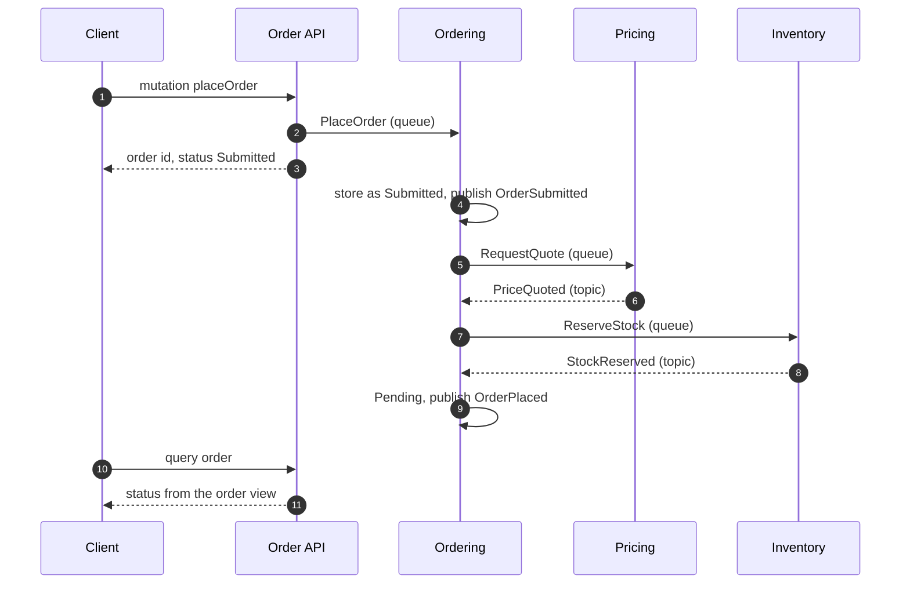

# ADR-0005: Receive the order at once, accept it after price and stock, all over Service Bus

- Date: 2026-11-14

## Context

Placing an order touches four things in three external systems: price, stock, payment, shipment.
There is no transaction that spans them. We must decide which steps the client waits for, who
coordinates the rest, and how partial failure is undone. The brief requires stock to be validated
*before* an order is accepted.

Services do not call each other over HTTP ([ADR-0003](0003-event-driven-communication.md)): every
service is an Azure Functions app whose functions are started by a Service Bus trigger. A request to
another service is a message on its queue, and the answer is an event. So no step of the flow can be
"inside the HTTP request" of the client.

## Decision

**The client is answered when the order has been received, not when it has been checked.**

1. The Order API ([ADR-0013](0013-cqrs-app-service.md)) validates the shape of the request, derives
   the order id, sends `PlaceOrder` to the `ordering-commands` queue and answers **"received"** (status `Submitted`)
   with the order id and the address of the order view.
2. Ordering stores the order as **`Submitted`**: received, not yet priced, no stock held.
3. Ordering asks Pricing for a quote, then asks Inventory to **reserve** the stock. Each is a command
   on the other service's queue, answered by an event.
4. Only when both answered well does the order become **`Pending`** and `OrderPlaced` is published.
   **This is the moment the order is accepted.** If the price cannot be given or stock is short, the
   order becomes `Rejected` with the reason, and the customer sees it in the order view.
5. From `Pending` the flow continues: ask Ecommerce for the payment of the final amount, confirm, request
   shipment, follow the carrier. A card payment needs the customer for strong customer authentication
   (3-D Secure), so Ecommerce answers with a redirect to the provider's hosted page, which the customer
   reaches from the order view ([ADR-0014](0014-personal-data-and-payment-regulation.md)).

**"Validated before accepted" still holds, with a precise meaning.** `Submitted` is not an accepted
order: no money is requested and nothing is promised. Payment is only requested from `Pending`, and
an order cannot reach `Pending` without a stock reservation. What changes is that the customer no
longer learns "out of stock" in the same response.

**Reserve, do not just check.** A check followed by a later decrement lets two customers buy the last
item. Reservation is all-or-nothing per order, keyed by order id (idempotent), and expires on the
inventory side so an orphan cannot hold stock forever.

**Fail closed.** If Inventory answers that its source is unavailable, the order is rejected. We do not
accept orders on the hope that stock exists.

**Orchestrate in Ordering.** One process manager, `OrderFulfillmentProcess`, reacts to events and tells
Pricing, Inventory, Ecommerce and Carriers what to do next. It holds no state of its own: the `Order`
aggregate and its status are the saga state. Each failure has a defined compensation (release stock,
reverse payment, cancel shipment), listed in the
[lifecycle document](../architecture/02-order-lifecycle.md#what-happens-when-something-fails).

**Make placement idempotent.** Clients send an `idempotencyKey` in the `placeOrder` input. The order id is derived from the
customer and the key, so a retry produces the same id, the same message id on the queue, and the same order.

## Alternatives considered

**Price and reserve inside the request, answer `201` or a precise error**. The
customer learns at once whether the order is accepted, which is the better experience at a checkout.
Not chosen because it needs a synchronous call from Ordering to Pricing and Inventory, and the
decision is that services talk only through Service Bus. The request-reply feature of Service Bus
sessions could imitate a synchronous call, but it keeps a function instance waiting, and it brings
back the coupling the rule is meant to remove.

**Everything synchronous** (reserve, charge and book shipping before responding). Rejected: response
time and availability become the product of three external systems, and a failure after the charge
leaves money taken with no order stored.

**Choreography** (Ecommerce listens to `OrderPlaced`, Carriers listens to `PaymentAuthorized`, and so on,
with no coordinator). Maximum decoupling. Rejected: the business process would exist only as the sum
of subscriptions in several services, nobody would own a failure in the middle, and adding a step means
editing its neighbours. Other consumers remain free to subscribe to order events.

**A saga framework or workflow engine** (for example Durable Functions). Rejected as premature for a
linear flow; reconsider if the process gains branches, timers and human steps.

## Consequences

- **The checkout cannot say "out of stock" in the response to "place order".** The front end must show
  "we are checking your order" and then read the order view, by polling or by a push notification.
  Under normal load the answer is there in well under a second, but it is a second request. This is
  the main cost of the decision and the first question to expect.
- **Card payments need a second customer step.** Under PSD2 the customer must authenticate the payment,
  so after acceptance the view sends them to the provider's payment page. The order can wait in
  `Pending` for the customer, and the `Pending` timeout must allow for it ([ADR-0014](0014-personal-data-and-payment-regulation.md)).
- The delivery offers and the stock shown on the product page reduce, but do not remove, late rejections.
- Receiving orders does not depend on Pricing, Inventory or Ordering being up: the queue holds the
  request. A peak is absorbed by the queue instead of by timeouts.
- An order can sit in `Submitted` or `Pending` if a service never answers. A timeout that rejects such
  orders is required and is on the backlog, together with an alert on dead-lettered messages
  ([ADR-0012](0012-reliable-messaging-without-an-outbox.md)).
- A reservation can exist for an order that was rejected or cancelled in the meantime. Ordering
  releases it when the reservation event arrives for such an order, and reservations expire.
- Ordering knows the contracts of four other services. That is the price of having the process in one place.
- Two more message hops before acceptance than a synchronous call: more to trace
  ([ADR-0008](0008-observability.md)), and slower by some tens of milliseconds.
