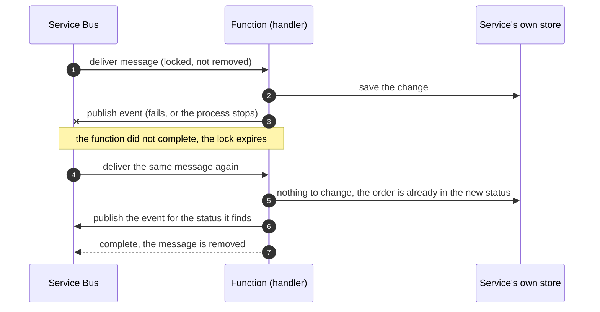

# ADR-0012: No outbox. The Service Bus trigger retries, handlers send from state, consumers keep an inbox

- Date: 2026-11-14

## Context

The platform is event driven ([ADR-0003](0003-event-driven-communication.md)). Every time an order
changes, a service must do **two things**:

1. save the change in its own store (Azure SQL for Ordering), and
2. tell the other services, by sending a message to Azure Service Bus.

These are two different systems and **no transaction covers both** (the dual-write problem). If the
process stops after the save and before the send, the order exists and nobody was told.

The usual answer is a transactional outbox: write the message into a table in the same transaction
as the change, and let a relay send it. It costs a table, a relay function and their operation in
every service that publishes.

One fact about this platform changes the calculation: **every step of every service is started by a
Service Bus message** ([ADR-0001](0001-microservices-and-function-per-feature.md)). A Service Bus
trigger uses peek-lock: the message is only removed from the queue when the function ends without an
error. If the function fails, or the process stops, the message is delivered again.

## Decision

**There is no outbox table and no relay. A handler saves and then publishes directly. If the publish
does not happen, the function fails, the trigger delivers the same message again, and the handler
runs again.** The incoming message plays the part of the outbox row: it stays until the work is complete.

This only works under three rules. They are the design, not details.

### Rule 1: send from the state, not from the change

On the second run the order is already in its new status, so a handler written as "if I changed
something, publish" would publish nothing and the event would be lost for good. Therefore:

- A handler decides what to publish **from the state it finds**. `OrderStore` publishes the events of
  the transitions it just saved, and if nothing changed it publishes the event of the order's current
  status again.
- The same holds for requests to other services. "The order is `Pending`, so payment must have been
  requested": the handler sends the request again, and Ecommerce answers again with the same result.
- Compensation is decided the same way: a reservation event that arrives for an order that is
  `Rejected` or `Cancelled` is released, whether or not this run made it so.

### Rule 2: the same fact always has the same message id

Running a handler again publishes the same event again. To make the repeat harmless, the event id is
**derived** from the order id, the event type and, where needed, a discriminator such as the version
(`IntegrationEventIds`). It is used as the Service Bus message id. Then:

1. **Service Bus duplicate detection** drops the repeat inside its time window.
2. **The consumer's inbox** records the ids it has handled, in the same write as its own state
   change, and skips an id it has seen. This is required where the effect is outside our store, above
   all calls to payment providers and carriers, which also carry an idempotency key derived from the
   order id ([ADR-0006](0006-external-integrations.md)).
3. **Handlers are idempotent by nature** where possible: confirming a confirmed order changes nothing.

### Rule 3: a dead-lettered message is a stuck order, and a person is told

Service Bus gives up after the maximum delivery count and moves the message to the dead-letter queue.
With an outbox that would be one lost delivery among several safety nets. **Here it is the only copy
of the intention to continue the order.** So:

- An alert fires on any message in a dead-letter queue ([ADR-0008](0008-observability.md)).
- There is a runbook and a tool to resubmit dead-lettered messages after the cause is fixed. The
  rules above make resubmitting safe.
- A timeout rejects orders that stay in `Submitted` or `Pending` too long
  ([ADR-0005](0005-order-placement-flow.md)).

### How a handler saves: one unit of work

Inside a handler, everything that belongs to the order is saved in **one database transaction**: the
aggregate, its lines, its history row and the inbox entry of the message being handled, committed
by one `SaveChanges` (EF Core's unit of work). Either all of it is stored or none of it is, so a
redelivered message never finds a half-saved order.

The unit of work stops at the database. It does not include the publish to Service Bus: Service Bus
does not join a SQL transaction, and Azure SQL has no distributed transaction coordinator for it.
The send after the commit is covered by the three rules above, not by the transaction.

Across services nothing is rolled back. A step that cannot continue publishes its failure, and
Ordering sends the **compensations** of the steps already done: release the stock, reverse the
payment, cancel the shipment ([02](../architecture/02-order-lifecycle.md#what-happens-when-something-fails)).

### Where a step is not started by a message

| Entry point | What holds the retry |
|-------------|----------------------|
| Order API receives the `placeOrder` mutation | It only sends one message. If the send fails the client gets an error and retries with the same `idempotencyKey`, which gives the same order id and message id |
| Webhook from a payment provider or a carrier | The handler answers with an error if it cannot publish, and the provider calls again. Providers that do not retry need a queue in front of the handler |
| Timers (order timeouts) | They read the state and send; the next run repeats what the last one missed |

### In the skeleton

| Element | Where | State |
|---------|-------|-------|
| `IEventPublisher`, `IntegrationEventIds` | `OrderProcessing.BuildingBlocks.Application` | Real |
| Save, then publish from the state | `OrderStore` in `OrderProcessing.Ordering.Application` | Real |
| `ServiceBusEventPublisher`, `ServiceBusCommandSender` | `OrderProcessing.BuildingBlocks.Azure` | Real code, compiled, never run against Service Bus |
| `InMemoryMessageBus` | `OrderProcessing.BuildingBlocks.Infrastructure` | Placeholder for Service Bus in the local host: one subscription per handler, redelivery up to three times, then dead-letter (a log entry) |
| `InMemoryInbox`, `IntegrationEventConsumer` | same | Placeholder for the inbox tables: a consumer handles a message id once |
| `MessagingTests`, `OrderFlowTests` | `tests/OrderProcessing.Modules.UnitTests` | The rules as tests, including a publish that fails and is repaired by running the handler again |
| `DeadLetterInspector` and the operations function app (`InspectDeadLetters` every five minutes, `OnResubmitRequest` on the `operations-resubmit` queue) | `OrderProcessing.BuildingBlocks.Azure`, `src/Host/OrderProcessing.Operations.Functions` | Compiled, never run against Service Bus. A resubmitted message gets a new message id, so duplicate detection lets it through, and keeps its event id, so consumers that already handled it skip it |
| Inbox tables, duplicate detection on the topics, the dead-letter alert rule, order timeout | | To build |

## Alternatives considered

**A transactional outbox with a relay.** The intention to publish is as durable
as the order, whatever happens to the incoming message, and "outbox lag" is a simple health signal.
It does not depend on every handler following rule 1. Not chosen: it adds a table, a timer function
and cleanup to each publishing service, and a delay of up to the relay interval at every step, to
cover a case the trigger already covers. **It becomes the right choice again** if a step appears that
is not started by a message and cannot be retried by its caller, or if dead-lettered orders turn out
to be frequent.

**Publish directly and ignore the failure.** Rejected: a lost `OrderPlaced` is a customer who never
hears again, and nothing fails visibly.

**Publish first, then save.** Rejected: it announces facts that may never become true.

**A distributed transaction across the database and the broker.** Rejected: Azure SQL and Service Bus
do not share a transaction coordinator.

**Change data capture** to derive events from the tables. Rejected for now: events would be shaped by
rows instead of business meaning, and it adds infrastructure.

**Event sourcing.** Rejected as disproportionate ([ADR-0004](0004-data-ownership-and-storage.md)).

## Consequences

- **Less to build and run**: no outbox table, no relay, no cleanup, in any service. The estimate drops
  by about 7 person-days for this package ([estimate](../estimation/01-high-level-estimate.md)).
- **No relay delay**: the next service is told as soon as the handler has saved.
- **Correctness now rests on a coding rule.** A handler that publishes only when it changed something
  loses messages silently, and nothing in the infrastructure catches it. It is a review rule and every
  handler has a "run it twice" test.
- **Events may be published before a concurrent reader sees the save, and more than once.** Consumers
  are idempotent; this was already a rule.
- **The safety window is the delivery count.** If Service Bus cannot be reached for longer than the
  retries of one message last, that message is dead-lettered and its order waits for a person. With an
  outbox it would have flowed by itself when the broker returned. Retry settings (delivery count, lock
  duration, backoff) are therefore chosen deliberately and the dead-letter alert is not optional.
- **Duplicate detection has a time window.** A repeat that arrives later is caught only by the inbox,
  so the inbox is needed wherever a repeat would do harm.
- A handler may repeat work on redelivery (read the order, send again). The cost is small and only on failures.
