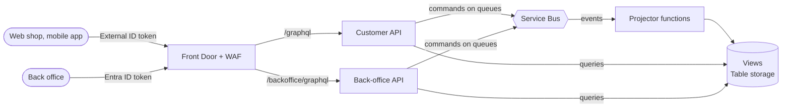

# ADR-0013: A CQRS Order API in front of the core, as a customer API and a back-office API

- Date: 2026-11-14

## Context

The front ends (web shop, mobile app, back office) need one place to send orders and read them.
Letting them call the core function apps directly would put public concerns (tokens, rate limits,
response shapes) into every core service, and make every order page a read on Ordering's Azure SQL.

The feature that shapes the read side is **order tracking**. Its record is not the Order aggregate:

- It holds **more**: "in transit", "ready for collection at the locker" are not order states, yet the
  customer wants to see them.
- It is fed by **several services**: Ordering, Ecommerce, Carriers, Documents.
- It is **read far more often than written**, by people waiting for a parcel.

A record with a different shape, different sources and a different load than the write model is the
case CQRS exists for. The callers also come in two audiences: customers (Entra External ID, own orders
only) and staff (Entra ID, any order).

## Decision

**The Order API is the only API the front ends call.** It separates commands from queries, owns no
business rules, and is deployed as two App Service web apps from one codebase, both speaking GraphQL
([ADR-0015](0015-graphql-for-the-presentation-apps.md)):

| App | Callers | Identity | Exposes |
|-----|---------|----------|---------|
| **Customer API** (`/graphql`) | Web shop, mobile app, any later customer front end | Entra External ID; customer id from the token | Place an order, cancel own order, my orders, one order with tracking, the payment action, delivery offers, files |
| **Back-office API** (`/backoffice/graphql`) | Support staff | Entra ID, roles such as `orders.read.all`, `orders.cancel.any` | Any order and its full timeline, orders of a customer, cancel any order, open and resolve disputes |

### Command side

- The app validates the token and scopes, checks the shape of the request, applies rate limits and
  **sends a command to the owning service's queue** ([ADR-0003](0003-event-driven-communication.md)).
- **Mutations answer "received", not the outcome.** `placeOrder` derives the order id from the customer
  and the `idempotencyKey` (a retry gives the same id), writes a placeholder view with status
  `Submitted`, sends `PlaceOrder` and returns the view. `cancelOrder` answers `accepted: true`; a refusal
  arrives as `OrderCancellationRefused` in the timeline.
- **Delivery offers** follow the same shape: `requestDeliveryOffers` writes a `Requested` view and sends
  `QuoteDeliveryOffers`; the carrier service answers with `DeliveryOffersQuoted`; the front end reads
  `deliveryOffers(requestId)`.
- The caller's identity and rights travel in the command; Ordering checks ownership again
  ([ADR-0007](0007-security.md)).

### Query side

- Queries read **views** only: one denormalised record per order (lines, price, status and history,
  payment, carrier, tracking, documents), the delivery offers view, and the files view.
- **Table storage**, owned by the Order API. PartitionKey = customer id, so a customer can only read
  their own partition; a second table keyed by order id serves the back office.
- **Projector functions** subscribe to `ordering-events`, `payments-events` and `shipping-events`. Each
  event carries the order's version; older events are ignored, so duplicates and reordering are harmless.
- `OrderPlaced` carries the order summary, so the projector never calls Ordering.
- Views can be rebuilt from Ordering's data.
- **Files**: the files view maps a file token to its container, path and owner. `file(token)` checks
  ownership and returns a read-only SAS link signed with the app's own identity
  ([ADR-0004](0004-data-ownership-and-storage.md#4-files-one-upload-lobby-a-file-token-read-links-signed-by-the-order-api)).

### What a view shows: specification rules

A client sees only what an event has confirmed. Small rules (`IViewSpecification`), each tested on its
own like a pricing rule, decide what a view may show:

| Rule | The client sees |
|------|-----------------|
| Only received (`Submitted`, version 0) | "Received", items and address as sent; no price, no "accepted" |
| Price only from `OrderPlaced` | Totals and delivery fee once accepted |
| Payment only from payment events | "Complete your payment" or "Paid" |
| Tracking only from carrier events | Carrier, tracking number, timeline |
| Last event older than the timeout for its status | The status, flagged to support as stuck |

Hiding an incomplete part never replaces fixing it: a stuck order is caught by the dead-letter alert
and the timeouts ([ADR-0012](0012-reliable-messaging-without-an-outbox.md)).

### Who owns the status

**The Order aggregate in Ordering.** A view is a copy. The projector writes views only, never
Ordering's data, and never sends a command that changes an order. Carrier detail between two states
goes straight into the view. If a view and Ordering disagree, Ordering is right and the view is rebuilt.

### Living with the delay

Views are normally well under a second behind. The placeholder (version 0) is the only part of a view
not built from an event, and claims nothing but "received". There is no fallback read from Ordering:
a late view shows an older status, never an error. Every view carries its version and update time, so
a client knows when to stop polling.

### Hosting

- **Customer API on the order intake plan** (the checkout waits on it), **back-office API on the
  on-demand plan**, one projector function app on the order flow plan ([ADR-0010](0010-service-plans-by-demand.md)).
- Separate managed identities. Only the back-office identity reads across customers.
- Front Door routes by path; the back-office route can be limited to the company network. Core
  function apps are not reachable from outside; provider webhooks go to the integration services.

### What it must not become

No business rules, no writes to another service's data, no decisions based on a view, no
orchestration. The boundary tests allow it to reference only `Contracts` packages
([ADR-0002](0002-service-structure-and-boundaries.md)).

## Alternatives considered

**Front Door straight to the core function apps.** One hop fewer. Not chosen: the core carries public
concerns, and reads load the write store.

**Azure API Management in front of the core.** Routing, rate limits and token validation as a product,
but no read model, and a cost step. It would sit in front of the Order API if third parties consume it.

**A read model inside Ordering.** One service fewer. Rejected: the views combine several services, and
reads would still land on the core.

**One app for every client**, with roles. Not chosen: two identity providers in one app is one
misconfigured policy away from a customer acting as staff; two apps make the boundary physical.

**A backend-for-frontend per client.** Not chosen: web shop and mobile app need the same commands and
views. A front end gets its own app only when the customer API cannot give it the shape it needs.

**Synchronous commands to Ordering.** A final answer at checkout. Not chosen: services talk only
through Service Bus ([ADR-0005](0005-order-placement-flow.md)).

**Azure SQL or Cosmos DB for the views.** Richer queries at a higher price. Table storage serves "by
customer" and "by order id"; free search in the back office is the signal to add a SQL read model.

## Consequences

- One place for client concerns, and a private core. Reads never touch Azure SQL.
- **Only the Order API and Service Bus must be up for orders to be received.**
- **The client reads the result**: every command is "received, look at the view". Push (SignalR or Web
  PubSub fed by the projector) is a later addition.
- If a send fails, the client retries with the same key; an orphan `Submitted` view is cleaned up by
  the order timeout.
- **More to run**: two web apps, a projector, view tables, a rebuild job. The second web app costs
  about two days and no extra compute at launch.
- `OrderPlaced` carries personal data; the retention and erasure rules apply to the views too
  ([ADR-0014](0014-personal-data-and-payment-regulation.md)).

### In the skeleton

| Element | State |
|---------|-------|
| `OrderProcessing.OrderApi` module: both schemas, commands, queries, projector, delivery offers | Real, in the local host; views in memory |
| Depth and cost limits, introspection off, schema files checked by `GraphQLApiTests` | Real |
| Specification rules | Applied inline by the projector; separate `IViewSpecification` classes to build |
| Table storage, two separate web apps, rebuild job, persisted queries, dispute mutations | To build |
