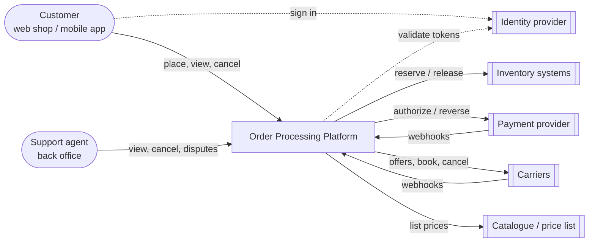
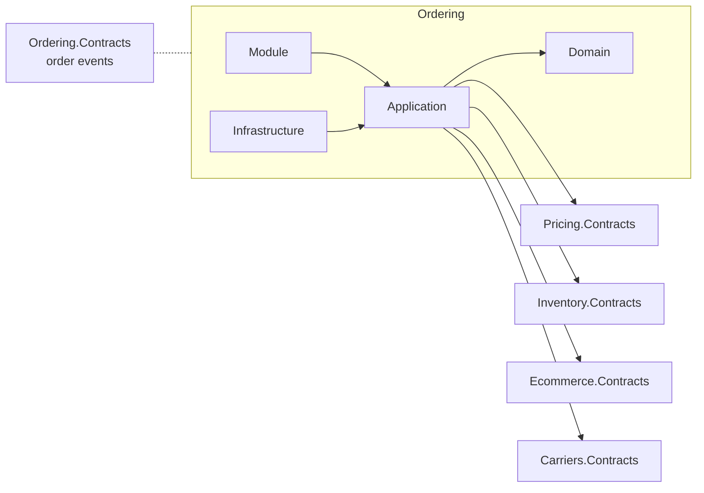

# 01 Overview

An order processing platform that takes customer orders, tracks them until delivery, and coordinates
the systems an order depends on: inventory, payment and shipping. This repository is the
implementation-ready skeleton: structure, boundaries, contracts and one running vertical slice.

## Assumptions

| # | Assumption | If it is wrong |
|---|-----------|----------------|
| A1 | One delivery team of 5 to 9 engineers builds and runs the platform. | Several teams would each own services, where microservices pay off most ([ADR-0001](../adr/0001-microservices-and-function-per-feature.md)). |
| A2 | Inventory, payment and shipping are existing systems behind HTTP APIs and webhooks, possibly several of each. We do not own their data. | A system we own (our own stock ledger) becomes a core service behind the same port. |
| A3 | The catalogue and price lists are owned elsewhere; Pricing reads list prices through a port. | A catalogue module is added; nothing else changes. |
| A4 | Callers are first-party clients (web shop, mobile app, back office) with OAuth 2.0 / OpenID Connect tokens. | Third-party consumers add API keys, quotas and stricter versioning. |
| A5 | Load of a mid-sized retailer: tens of orders a second at peak, not thousands. | Higher volume brings Service Bus Premium and larger plans forward. |
| A6 | Azure is the organisation's cloud. Azure SDKs sit at the edges; domain and application code reference none. | Another cloud changes the hosting ADRs and the infrastructure code, not the business logic. |
| A7 | Returns, refunds after delivery, partial shipments and order amendments are out of scope. | They extend the state machine ([02](02-order-lifecycle.md)). |

## Scope: what the brief requires and what was added

| Part of the design | Source | At launch |
|--------------------|--------|-----------|
| Create, retrieve, cancel orders; track the lifecycle | Brief | Yes, in the skeleton |
| Validate inventory before accepting | Brief | Yes: `Submitted` becomes `Pending` only after stock is reserved |
| Pricing with taxes and charges | Brief | Yes: rule pipeline, placeholder rules |
| External inventory, payment and shipping | Brief | Yes, one real party of each kind; fakes in the skeleton |
| Non-functional requirements | Brief | Yes ([03](03-quality-attributes.md)) |
| Microservices, one function per feature; Service Bus only; no outbox | Design decision | Yes |
| Azure, plans split by demand | Design decision | Yes |
| CQRS Order API with tracking views | Extension | Yes |
| Documents service: upload lobby, file tokens, SAS links | Extension | Yes, for labels and delivery photos |
| Several parties behind each integration service | Extension | The resolvers, with one party each |
| Notifications by email, SMS and push | Extension | Yes, in the skeleton with fake vendors |
| Effort estimate and Azure cost forecast | Addition | Not part of the system |
| Customer sign-up | Not in the brief | Entra External ID |
| Returns, partial shipments, amendments, one order from several sources | Not in the brief | No ([06](06-integration-services.md#one-order-from-several-inventories)) |

The extensions sit where a real order platform is extended first: launching with one party is cheap,
and adding the next touches no other service.

## Architectural drivers

Ranked; the higher one wins a conflict.

1. **Correctness of an order.** Never lost, never charged twice, never promised stock that does not exist.
2. **Changeability.** Pricing rules, providers and lifecycle steps change most often.
3. **Independence of services.** Each deploys, scales and fails on its own.
4. **Operability by a small team.** Shared templates, one pipeline shape, managed Azure services.

## System context



## Services

Each row is a module in the skeleton and an independent service on Azure
([ADR-0001](../adr/0001-microservices-and-function-per-feature.md)). They talk only through Service
Bus: a command on the service's queue, an event on its topic ([ADR-0003](../adr/0003-event-driven-communication.md)).
The container view is in the [README](../../README.md#the-platform-on-one-page) and the Azure view in [05](05-azure-reference-architecture.md).

| Module | Responsibility | Owns | Kind |
|--------|----------------|------|------|
| **Order API** | The only API the front ends call: commands to queues, queries from views. Customer API and back-office API. | Views (Table storage) | CQRS app service ([ADR-0013](../adr/0013-cqrs-app-service.md)) |
| **Ordering** | The order lifecycle; orchestrates fulfilment. | Orders, history (Azure SQL) | Core |
| **Pricing** | Basket to quote: prices, charges, taxes. | Pricing rules | Core |
| **Documents** | One upload lobby, scan, typed containers, file tokens, retention. | Blobs, file records | Supporting ([ADR-0004](../adr/0004-data-ownership-and-storage.md)) |
| **Inventory** | Which source can supply the items; reserve and release. | Sources, routing rules, reservations | `inventory-integration-service` |
| **Ecommerce** | Payments with the provider for the payment method. | Providers, payment attempts | `ecommerce-integration-service` |
| **Carriers** | Delivery offers, booking with the chosen carrier, tracking. | Carriers, rate cards, shipments | `carrier-integration-service` |
| **Notifications** | Email, SMS and push about the order, by policy. | Policy, contact copy, sent log | `notification-integration-service` |

Each service has one reason and one rate of change: Pricing with commercial policy, integration
services with their providers, Ordering with the business process.

### How services depend on each other



Enforced by [architecture tests](../../tests/OrderProcessing.ArchitectureTests/ModuleBoundaryTests.cs)
that fail the build:

1. A service uses another only through its `Contracts` package.
2. `Contracts` depend only on the building-block abstractions.
3. `Domain` depends only on the shared kernel; `Application` knows nothing of the web or the database.
4. Outside `Contracts` and `Domain`, only the module entry point and its options are `public`.
5. A service's data is private: no cross-service joins, foreign keys or table reads.

Ordering depends on the contracts of the four services it orchestrates; none of them knows Ordering.
They answer with events. Notifications and the Order API depend only on `Ordering.Contracts`.

## Solution structure

```
src/
  Host/OrderProcessing.Host                  Local composition root: all modules, in-memory infrastructure
  Host/OrderProcessing.Operations.Functions  Operations tool: dead letters and resubmit
  BuildingBlocks/                            Result, Error, aggregate root, handlers, events, in-memory bus
  Modules/
    Ordering/      Contracts, Domain, Application, Infrastructure, Module, Functions
    Pricing/ Inventory/ Ecommerce/ Carriers/ Notifications/
                   Contracts and implementation; Functions hosts for Ecommerce and Notifications
    OrderApi/      GraphQL schemas, views, projector
tests/             Unit tests, architecture tests
```

Layering is proportional to complexity ([ADR-0002](../adr/0002-service-structure-and-boundaries.md)):
Ordering has four layers, a service with one port and its adapters has one project.

## Technology

| Concern | Choice | Decision |
|---------|--------|----------|
| Style | Microservices, event driven, clean architecture, one function per feature | [ADR-0001](../adr/0001-microservices-and-function-per-feature.md) |
| Runtime | .NET 10, Azure Functions isolated worker; Hot Chocolate GraphQL on ASP.NET Core | [ADR-0015](../adr/0015-graphql-for-the-presentation-apps.md) |
| Persistence | Azure SQL (Ordering), Table storage, Blob storage with SAS links | [ADR-0004](../adr/0004-data-ownership-and-storage.md) |
| Messaging | Service Bus queues and topics, triggers, no outbox | [ADR-0003](../adr/0003-event-driven-communication.md), [ADR-0012](../adr/0012-reliable-messaging-without-an-outbox.md) |
| External calls | Typed `HttpClient` with `Microsoft.Extensions.Http.Resilience` | [ADR-0006](../adr/0006-external-integrations.md) |
| Security | OAuth 2.0 / OIDC, JWT bearer, scopes, ownership checks | [ADR-0007](../adr/0007-security.md) |
| Observability | OpenTelemetry over OTLP | [ADR-0008](../adr/0008-observability.md) |
| Hosting | Functions apps on Windows App Service plans split by demand | [ADR-0009](../adr/0009-azure-hosting.md), [ADR-0010](../adr/0010-service-plans-by-demand.md) |
| Deployment | Terraform; one package per service, slot swap | [ADR-0011](../adr/0011-deployment.md) |
