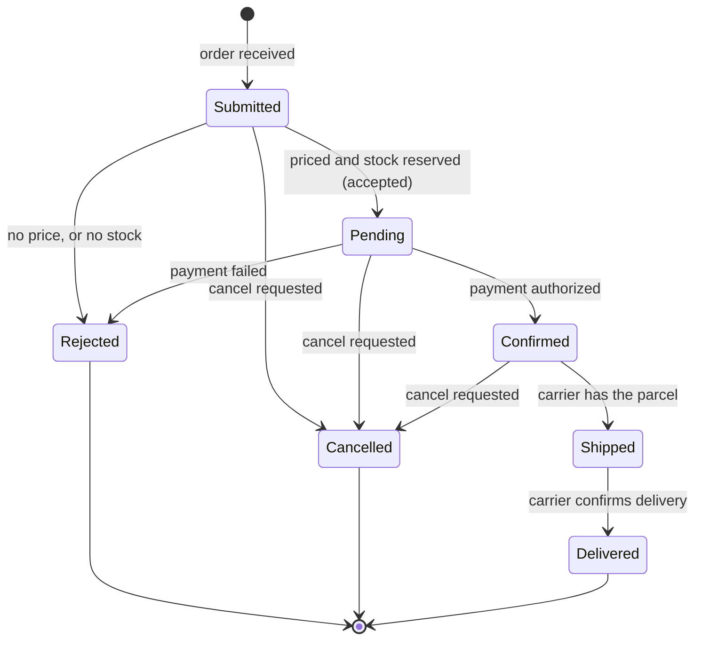
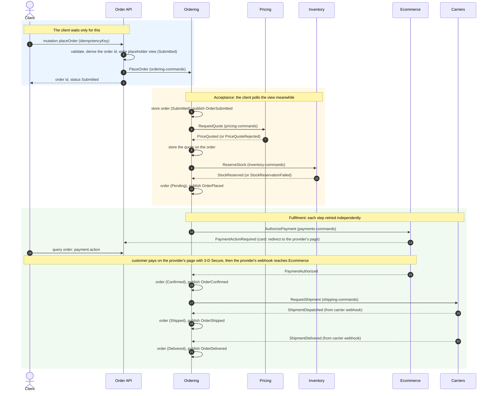
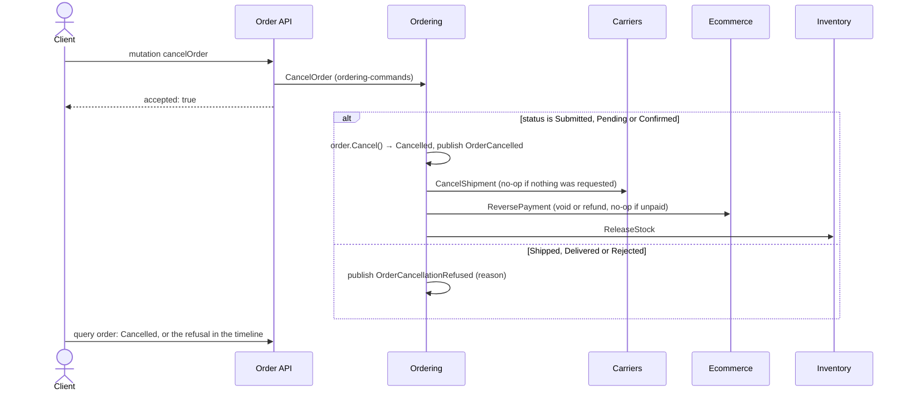

# 02 Order lifecycle

The lifecycle is owned by the `Order` aggregate
([Order.cs](../../src/Modules/Ordering/OrderProcessing.Ordering.Domain/Order.cs)). Every status change goes
through a method on the aggregate, is appended to the order's history, and is published as an integration event.

## States

| Status | Meaning | Cancellable | Event published on entry |
|--------|---------|:-----------:|--------------------------|
| `Submitted` | Received. Not yet priced, no stock held, nothing promised. | yes | `OrderSubmitted` |
| `Pending` | **Accepted.** Price fixed, stock reserved, payment in progress. | yes | `OrderPlaced` |
| `Confirmed` | Paid. Shipment requested. | yes | `OrderConfirmed` |
| `Shipped` | Handed to the carrier. | no | `OrderShipped` |
| `Delivered` | Terminal. | no | `OrderDelivered` |
| `Cancelled` | Terminal. Cancelled on request. | | `OrderCancelled` |
| `Rejected` | Terminal. The platform could not complete it. | | `OrderRejected` |

Notes on the model:

- **An order is received before it is checked, and accepted only after.** The client gets "received" when
  the order is `Submitted`. Price and stock are checked next, over Service Bus. `Pending` is the
  accepted order: it cannot be reached without a stock reservation, and payment is requested only
  from there. This is what "validate inventory before accepting an order" means here
  ([ADR-0005](../adr/0005-order-placement-flow.md)).
- **A request that is malformed never becomes an order**: the mutation answers with an `error` (a stable `code` and a message) and nothing is queued. A well-formed
  order that cannot be priced or has no stock is stored and ends as `Rejected` with the reason.
- **`Cancelled` and `Rejected` are separate** because they answer different questions: who ended the order
  (the customer or the platform), and therefore which message the customer receives and which report it appears in.
- **Transitions are idempotent.** Repeating the transition that already happened succeeds without
  effect, because events are delivered at least once.
- **Lifecycle tracking** is the `tracking` timeline on the `order` query (the order view) plus the event stream.
  Fine-grained carrier tracking belongs to the carrier service, not to the order status.

## The order and its lines

An order holds **one or more products**. The same product list exists in two forms, and the difference
is a design decision:

| | **Item** (what the customer asked for) | **Line** (what the customer agreed to pay) |
|---|---|---|
| Fields | `sku`, `quantity` | `sku`, `name`, `quantity`, `unitPrice`, `lineTotal` |
| Who sets it | The client, in `placeOrder(input: { items: [...] })` | Pricing, in `PriceQuoted`. Ordering stores it as a snapshot. |
| Exists from | `Submitted` | `Pending` (empty before the order is priced) |
| In the code | `OrderItem` | `OrderLine`, stored with the `OrderPrice` snapshot |
| In the schema | `OrderItemInput`, `Order.items` | `Order.summary.lines` |

- **The client never sends a price or a product name.** It sends what it wants. The price comes from
  Pricing, so a changed request cannot change what is charged.
- **The lines are a snapshot.** A later change to the price list or to a product's name does not change
  an order that was already placed. The snapshot must add up: the line totals plus charges, taxes and
  discounts equal the order total, in one currency, or the aggregate refuses it.
- **Rules checked when the order is submitted** ([Order.cs](../../src/Modules/Ordering/OrderProcessing.Ordering.Domain/Order.cs)):

  | Rule | Error code |
  |------|------------|
  | At least one item | `order.no_lines` |
  | Every quantity is greater than zero | `order.invalid_quantity` |
  | A product appears once. More of it is a higher quantity, not a second item. | `order.duplicate_sku` |

  Whether a product exists, may be sold to the destination and is in stock is not Ordering's
  knowledge. Pricing and Inventory answer that, and the order is `Rejected` with their reason.
- **An order is accepted or rejected as a whole.** There is no partly accepted order: if one line has no
  stock, nothing is reserved and the order is rejected. A line is not changed or removed after the
  order is placed (assumption A7).
- **A line does not say where the product comes from.** Which warehouse or partner supplies each line
  is decided by the inventory service and kept in its reservation
  ([06](06-integration-services.md#inventory-integration-service-inventory-as-a-service)). Ordering
  does not know about warehouses.
- **Storage:** items and lines are owned collections of the `Order` row in Azure SQL, written in the
  same transaction as the order ([ADR-0004](../adr/0004-data-ownership-and-storage.md)).

## Placing an order

Every arrow between services is a Service Bus message: a command on the service's queue, or an event
on its topic ([ADR-0003](../adr/0003-event-driven-communication.md)). The only HTTP is between the
client and the Order API.

The whole sequence after the "received" answer is one class, the process manager
[OrderFulfillmentProcess.cs](../../src/Modules/Ordering/OrderProcessing.Ordering.Application/OrderFulfillmentProcess.cs),
so the sequence and its compensations can be read in one place. The Order API's projector listens to
the same events and keeps the order view up to date ([ADR-0013](../adr/0013-cqrs-app-service.md)).

## Cancelling an order

Cancelling is a message of its own, not a check in the presentation app. The `cancelOrder` mutation
puts `CancelOrder` on Ordering's command queue and answers "received". It does not read the order view
to decide, because the view is a copy that can be a moment behind. Ordering, the only owner of the
status, checks the order and publishes what follows from it:

| Status when `CancelOrder` is handled | Ordering publishes | What follows |
|--------------------------------------|--------------------|--------------|
| `Submitted`, `Pending` or `Confirmed` | `OrderCancelled` | `CancelShipment`, `ReversePayment` and `ReleaseStock` to the owning services |
| `Shipped`, `Delivered` or `Rejected` | `OrderCancellationRefused` with the reason | Nothing changes. The refusal shows in the order's timeline. |
| Already `Cancelled` | Nothing | A repeated request succeeds without a second event. |
| Unknown order, or not the caller's order | Nothing | Dropped without an answer, so nobody learns whether another customer's order exists. |

The compensations run from the `OrderCancelled` event, so a slow provider cannot block the
cancellation. All three are sent whatever the status was, and each is a no-op where there is nothing to
undo. They are not chosen by status on purpose: a reservation or a payment may still be in flight when
the order is cancelled, and the status does not show that.

## What happens when something fails

| Failure | Behaviour | Why it is safe |
|---------|-----------|----------------|
| Client times out and retries the `placeOrder` mutation | Same `idempotencyKey` gives the same order id and the same message id. | The queue's duplicate detection and `PlaceOrderHandler` both recognise the repeat; no duplicate order or charge. |
| Service Bus cannot be reached when the order is submitted | The mutation fails with an error; the client retries with the same key. | Nothing was promised. A placeholder view may remain and is cleaned by the order timeout. |
| Stock is short | `StockReservationFailed` → `Rejected` (`inventory.insufficient_stock` and the SKUs). The customer sees it in the view. | Reservation is all-or-nothing per order. |
| Basket cannot be priced (unknown SKU, expired delivery offer) | `PriceQuoteRejected` → `Rejected` with the reason. | Nothing was reserved yet. |
| Inventory or Pricing is down | Their command waits in the queue. The order stays `Submitted` and is accepted when the service returns, or rejected by the timeout. | Receiving orders does not depend on them. Fail closed: no acceptance without a reservation. |
| The inventory source is unreachable | `StockReservationFailed` (`inventory.unavailable`) → `Rejected`. | We never accept an order we cannot back with stock. |
| Customer cancels while the stock is being reserved | `StockReserved` arrives for a `Cancelled` order: the reservation is released. | Decided from the order's state, so a repeat releases again harmlessly. |
| Process stops after saving the order and before publishing | The incoming message was not completed, so Service Bus delivers it again; the handler finds the order in its new status and publishes the event for it. | No outbox: the trigger is the retry, handlers send from state, event ids are deterministic ([ADR-0012](../adr/0012-reliable-messaging-without-an-outbox.md)). |
| Payment provider is down | The handler fails and the message is redelivered with backoff. The order stays `Pending`. | Authorization is idempotent per order id. A `Pending` timeout (below) bounds the wait. |
| Payment is declined | `PaymentFailed` → `Rejected` → stock released. | |
| Customer leaves the payment page without paying | Order stays `Pending`; a "complete your payment" link asks for a fresh session; the `Pending` timeout rejects it and releases stock. | The return to our site decides nothing; only the provider's signed webhook or the reconciliation timer does ([07](07-data-protection-and-compliance.md#card-payment-with-strong-customer-authentication)). |
| Customer cancels while payment is in flight | `PaymentAuthorized` arrives for a `Cancelled` order: the transition is refused and the payment is reversed. | The aggregate rejects the late confirmation; the process manager compensates. |
| Shipment request fails | Retried from the `OrderConfirmed` event. Order stays `Confirmed`. | Shipment creation is idempotent per order id. |
| The chosen carrier refuses the shipment of a paid order | `ShipmentFailed` → Ordering opens a **dispute** on the order (`OrderDisputeOpened`, reason `shipment.refused`). The order stays `Confirmed`; the dispute is recorded in its history, the customer is notified, and the back office lists it. The company decides the outcome ([disputes](#disputes)). | No other carrier is booked behind the customer's back. |
| Carrier dispatches a parcel for an order cancelled seconds earlier | `ShipmentDispatched` is refused by the aggregate and logged for follow-up. | Known limitation: this becomes a return, which is out of scope (A7). |
| The same event is delivered twice | Second delivery is a no-op. | Idempotent transitions and idempotent provider calls. |
| A message cannot be processed after the maximum delivery count | Dead-lettered. **The order is stuck** until a person resubmits the message; an alert is raised. | Does not block other orders. Resubmitting is safe because handlers are idempotent. This is the price of having no outbox. |

### Disputes

A dispute is a complaint about an order that the company settles by hand. It is opened in two ways:

- **By the platform**, when the chosen carrier refuses a paid order (`ShipmentFailed`).
- **By staff in the back office**, when the customer writes to support about an order: the
  `openDispute` mutation of the back-office API, with the customer's message as the reason.

Ordering records it on the order (`OrderDisputeOpened`, source `carrier` or `customer`). The order
keeps its status, and the timeline shows the dispute. There is no time limit: it stays open until
staff record a result with `resolveDispute`, and Ordering publishes `OrderDisputeResolved` with the
outcome:

| Outcome | What follows |
|---------|--------------|
| `refund` | `ReversePayment` refunds the customer; an order not yet shipped is also cancelled and its stock released |
| `no_refund` | Nothing more; the reason is kept on the order |

Either way the notification service tells the customer the result. Whether to refund is the
company's decision, never the platform's.

### Rules decided for launch

Not in the skeleton yet; each is a package in the [build order](04-implementation-guide.md#suggested-build-order).

- **Timeouts.** An order still `Submitted` after 10 minutes, or `Pending` without payment after 30
  minutes, is rejected and its stock released, by a scheduled check that calls `order.Reject(...)`.
- **How the customer learns the result.** The app polls the order view; the notification service also
  sends the accepted or rejected message by email and push.
- **Capture on dispatch.** The payment is authorized with 3-D Secure after acceptance and captured on
  `OrderShipped`. Orders ship within the life of an authorization.
- **One source per order** ([06](06-integration-services.md#one-order-from-several-inventories)).
- **Disputes have no time limit** ([disputes](#disputes)). The back office lists open disputes oldest first.
- **Returns and partial shipments are out of scope (A7).** Adding them means new states
  (`ReturnRequested`, `PartiallyShipped`) in the state machine and the process manager.
