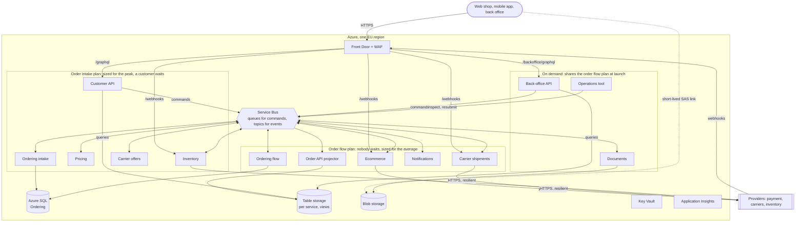
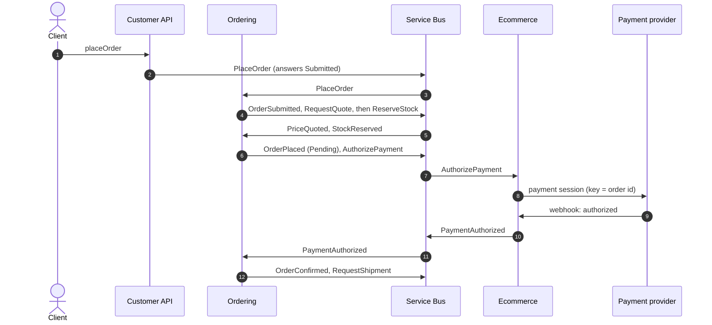

# 05 Azure reference architecture

Every service is its own Azure Functions app on Windows App Service plans grouped by demand, connected
only by Service Bus ([ADR-0001](../adr/0001-microservices-and-function-per-feature.md),
[ADR-0009](../adr/0009-azure-hosting.md), [ADR-0010](../adr/0010-service-plans-by-demand.md)).

## Deployment view

Inside a service, a function turns its trigger (a Service Bus message or a timer) into a command and
calls the handler; the handler uses the domain and the ports; Azure sits in adapters.

## Service mapping

| Concern | Azure service | Notes |
|---------|---------------|-------|
| Order API | **App Service**, two web apps from one codebase | Customer API on the intake plan, back-office API on the on-demand plan ([ADR-0013](../adr/0013-cqrs-app-service.md)) |
| Core, supporting and integration services | **Azure Functions** on Windows App Service plans | Service Bus and timer triggers; HTTP only for provider webhooks. Ordering is two apps (intake, flow). Staging slot per app |
| Plans | **App Service plans by demand** | Order intake alone; order flow and on-demand work share a second plan at launch |
| Messaging | **Service Bus Standard** | Queue per service for commands, topic per service for events, subscription per consumer and event, duplicate detection, dead-letter alert |
| Data of record | **Azure SQL Database** | Ordering only, with a geo-secondary in the paired region |
| Integration state, views | **Table storage** | Each service owns its tables, keyed by order id |
| Files | **Blob storage** | Private containers, a lobby, user delegation SAS links |
| Identity | **Entra External ID** (customers), **Entra ID** (staff), **managed identities** | No passwords or keys in configuration |
| Secrets | **Key Vault** | Provider keys, webhook secrets, offer signing key |
| Edge | **Front Door** with WAF | One public entry; the back-office route can be limited to the company network |
| Observability | **Application Insights** on Log Analytics | OpenTelemetry; one trace across API, Service Bus and functions |
| Infrastructure as code | **Terraform** | Reviewed and scanned plans, applied by the pipeline ([ADR-0011](../adr/0011-deployment.md)) |
| Pipeline | **GitHub Actions** with OIDC | One workflow per service: build, test, package, slot, swap |

## Message flow for an order

Each handler saves its state and inbox entry in one transaction, then publishes; a failure in between
is repaired by redelivery ([ADR-0012](../adr/0012-reliable-messaging-without-an-outbox.md)).

## Data

**Azure SQL with controlled execution:** parameterised EF Core queries only; each managed identity is a
database user limited to its schema, no DDL at runtime; migrations are reviewed scripts run by the
pipeline; human write access is just-in-time through Entra and audited; auditing and Query Store on.

**Table storage:** references, inbox entries and last known statuses, keyed by order id so the writes
for one order are atomic. Not for reporting.

**Files** ([ADR-0004](../adr/0004-data-ownership-and-storage.md#4-files-one-upload-lobby-a-file-token-read-links-signed-by-the-order-api)):

1. **Upload.** The client gets a file token and a write-only SAS for `lobby/{token}` from the Order API.
2. **Lobby to container.** Event Grid reports the blob to Documents, which checks size and type, waits
   for the Defender malware scan, copies the file to its container, records it and publishes
   `DocumentStored`. The lobby empties after 24 hours.
3. **Download.** The Order API checks ownership of the token and returns a read-only user delegation
   SAS for one blob, valid for minutes. The API never streams files. Account keys are disabled.

## Networking: private only where required

| Step | What | Extra a month |
|------|------|---------------|
| **1. Launch** | Public endpoints, Entra only; apps reachable only through Front Door | none |
| **2. Private data** | Private endpoints for SQL, Storage, Key Vault | a few tens of euros |
| **3. Private messaging** | Service Bus Premium with a private endpoint | about €600 |
| **4. Private inbound** | Application Gateway with WAF | a few hundred euros |

Each step needs a named requirement ([cost forecast](../estimation/02-azure-cost-forecast.md#the-cost-of-going-private)).

## Environments and recovery

Test, staging and production, each with its own budget. One region for the apps; a geo-secondary of
the Ordering database in the paired region (recovery point 15 minutes); geo-redundant storage. The
environment is rebuilt by Terraform in 12 hours ([03](03-quality-attributes.md#targets)).

## From the skeleton to Azure

Domain and application code move unchanged. What changes is in hosts and infrastructure: a Functions
host per service, the Service Bus transport (already compiled in `OrderProcessing.BuildingBlocks.Azure`),
EF Core on Azure SQL, Table storage repositories, the Documents service, and the Azure Monitor
exporter and Entra validation by configuration.
