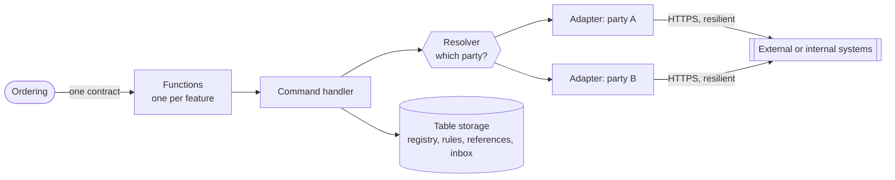
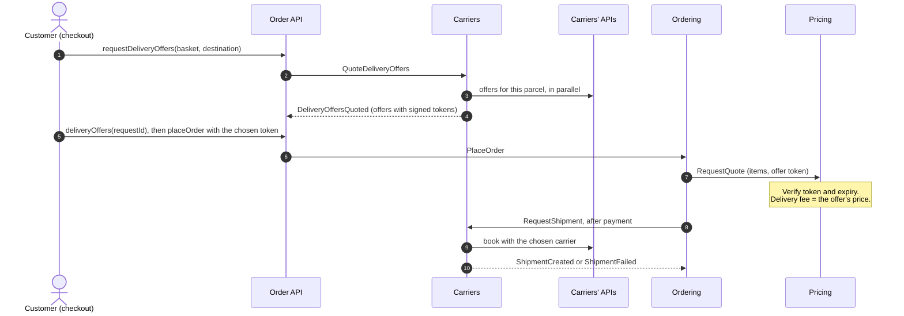

# 06 Integration services

The platform reaches the outside world through four integration services. Each gives the core one
stable contract and hides how many parties are behind it and which one is used
([ADR-0006](../adr/0006-external-integrations.md)).

| Service | Capability | Parties behind it | Module | Demand tier ([ADR-0010](../adr/0010-service-plans-by-demand.md)) |
|---------|-----------|-------------------|--------|-------------|
| **ecommerce-integration-service** | Payments | Payment providers, by payment method | `Ecommerce` | Order flow |
| **inventory-integration-service** | Inventory as a service | In-house stock and partner warehouses | `Inventory` | Order intake |
| **carrier-integration-service** | Shipping | Several carriers; the customer chooses from their offers | `Carriers` | Order intake (offers), order flow (booking, tracking) |
| **notification-integration-service** | Customer notifications | Azure Communication Services (email, SMS), Notification Hubs (push) | `Notifications` | On demand |

The brief asks for one inventory, payment and shipping system; several parties behind each contract
is an extension for extensibility. Launch has one real party per capability
([launch decisions](#launch-decisions)).

Queue, topic and event names follow the capability (`payments-*`, `inventory-*`, `shipping-*`) and do
not change if a service is renamed. So the carrier service is `carrier-integration-service` as a
deployment, `Carriers` as a module, and is asked for shipping: `shipping-commands`, `RequestShipment`.

The operations function app (dead-letter inspector, resubmit) is a tool for the people who run the
platform, not an integration service; it lives next to the hosts.

## The common shape

1. **A contract in our language**: "reserve these items", "authorize this amount", "ship this order".
   The core never names a warehouse, provider or carrier.
2. **A function per feature** running its command and handler ([ADR-0001](../adr/0001-microservices-and-function-per-feature.md)).
3. **A resolver** that picks the party from a registry and rules in the service's own tables, so parties
   are enabled and prioritised by configuration, without a deployment.
4. **One adapter per party** behind one port. It owns the party's DTOs, authentication, errors,
   timeouts and idempotency key.

State is in Table storage keyed by order id ([ADR-0004](../adr/0004-data-ownership-and-storage.md)).
No integration service holds rules about orders; those are in Ordering.

## ecommerce-integration-service (payments)

Gets a payment authorized, captured, reversed or refunded with the right provider, and reports the
outcome as an event. The name is the bank's term for online card acceptance (hosted page, 3-D Secure,
wallets, refunds); it does not integrate a shop system.

| Function | Trigger | Result |
|----------|---------|--------|
| `AuthorizePayment` | `payments-commands` | `PaymentActionRequired`, then `PaymentAuthorized` or `PaymentFailed` |
| `ReversePayment` | `payments-commands` | `PaymentReversed` (void or refund) |
| `OnProviderCallback` | HTTP `POST /webhooks/payments/{provider}` | The same events, when the provider answers later |
| `ReconcilePayments` | Timer | Closes attempts whose callback never arrived |

- **Resolver:** by payment method, then by rule where two providers offer the same method.
- **Port:** `IPaymentProvider` (authorize, capture, void, refund, verify callback signature).
- **Tables:** `PaymentProviders`, `PaymentAttempts` (PartitionKey = order id), `Inbox`.
- **No card data** reaches the service; it is the whole PCI-relevant surface ([ADR-0014](../adr/0014-personal-data-and-payment-regulation.md)).
- **Idempotency key** `order-{id}-attempt-{n}`: a redelivered command cannot charge twice.

## inventory-integration-service (inventory as a service)

Answers one question for the core: *can these items be supplied, and if so, hold them.* The caller
does not know whether the stock is ours, a partner's, or both.

| Function | Trigger | Result |
|----------|---------|--------|
| `ReserveStock` | `inventory-commands` | `StockReserved` or `StockReservationFailed`; all or nothing, fails closed |
| `ReleaseStock` | `inventory-commands` | Hold released (order cancelled or rejected) |
| `CommitStock` | `OrderShipped` | The hold becomes a deduction at the source |
| `ExpireReservations` | Timer | Releases holds whose order never arrived |
| `OnSourceCallback` | HTTP `POST /webhooks/inventory/{source}` | Asynchronous confirmations and pushed stock levels |

**How a reservation is resolved:**

1. **Validity**: the item is known and sellable to the destination, the quantity within limits.
2. **Candidate sources** from `RoutingRules` (by item group, destination, channel), in priority order.
3. **Allocation**: one source for the whole order, the first that has everything.
4. **Reserve** with the order id as idempotency key, in parallel, inside a 2-second budget.
5. **All or nothing**: what was held is released if any part fails; Ordering never sees a partial hold.

- **Port:** `IInventorySource` (check, reserve, release, commit). A source without a reserve operation
  gets an adapter that keeps the hold in our own table.
- **Tables:** `InventorySources`, `RoutingRules`, `Reservations` (PartitionKey = order id), `Inbox`.
- The allocation travels in `OrderPlaced`, so the carrier service knows where the parcel starts.
- Our own stock is a source like any other. Managing it here (receipts, adjustments) would be a core
  service of its own behind the same port.

### One order from several inventories

**Launch: one source per order, or the order is rejected as out of stock.** Splitting is an extension
behind the same `ReserveStock` contract, because the reservation already allocates per line:

| | **One source or refuse** (launch) | **Several parcels** | **Consolidate at our warehouse** |
|---|---|---|---|
| The customer gets | One parcel, or "out of stock" | One parcel per source | One parcel, later |
| It needs | Nothing more | A shipment, delivery choice and charge per parcel | Inbound transfers, a receiving step and a fulfilment plan outside the `Order` aggregate |
| The hard part | Some orders are lost | Charging per parcel | A failed inbound leg after payment needs a partial refund |
| Effort | Built | Medium | 30 to 45 person-days |

## carrier-integration-service (shipping)

Collects what every carrier offers, hands the list to the customer, books exactly what was chosen,
and translates every carrier's tracking into one set of events. **The platform owns no selection
policy**: carriers offer, the customer chooses.

| Function | Trigger | Result |
|----------|---------|--------|
| `QuoteDeliveryOffers` | `shipping-commands` | `DeliveryOffersQuoted` for the customer who asked |
| `RequestShipment` | `shipping-commands` | `ShipmentCreated` or `ShipmentFailed` |
| `CancelShipment` | `shipping-commands` | `ShipmentCancelled` |
| `OnCarrierCallback` | HTTP `POST /webhooks/carriers/{carrier}` | `ShipmentDispatched`, `ShipmentDelivered`, `ShipmentTrackingUpdated` |
| `PollTracking` | Timer | The same events, for carriers without webhooks |

- **An offer** has a carrier, a type (home, locker, pickup point), the locker or point, a price, an
  estimated date and an expiry. Carriers that cannot serve the parcel make no offer; one that does
  not answer in time is missing from the list. The client sorts and filters.
- **Signed offer tokens.** The token is signed with a Key Vault key and binds carrier, service, price,
  destination, currency and expiry, and in production also the basket (weight and volume). Pricing verifies it with the public
  key and takes the delivery fee from it, so a client cannot change the price and Pricing never calls
  this service.
- **Booking follows the choice.** If the chosen carrier refuses, no other carrier is booked:
  `ShipmentFailed` opens a [dispute](02-order-lifecycle.md#disputes) that the company settles.
- **Tracking is normalised.** Ordering only sees `Dispatched` and `Delivered`; "ready for collection"
  and "out for delivery" go to the tracking view only.
- **Port:** `ICarrier` (offer, book, cancel, track, verify callback). A carrier without a rate API
  offers from its rate card.
- **Tables:** `Carriers`, `RateCards`, `Offers`, `Shipments` (PartitionKey = order id), `TrackingEvents`, `Inbox`.
- **Front ends never call this service**; they ask the Order API ([ADR-0013](../adr/0013-cqrs-app-service.md)).
  Only carriers call it, through their webhooks. Offers run on the order intake plan, because a
  customer waits; booking and tracking on the order flow plan.

## notification-integration-service (email, SMS, push)

Tells the customer what happened to their order. **It is a consumer, not a step**: it subscribes to
events the other services already publish, and Ordering does not know it exists. If it is down, orders
still flow and messages go out late.

| Channel | Port | Vendor | Notes |
|---------|------|--------|-------|
| Email | `IEmailSender` | Azure Communication Services Email | From the shop's domain (SPF, DKIM, DMARC) |
| SMS | `ISmsSender` | Azure Communication Services SMS | Sender is the shop's name; Twilio behind the same port if ACS cannot send it in Greece |
| Push | `IPushSender` | Azure Notification Hubs | Apple and Google, for the mobile app |

All are Azure services: managed identity, no API keys, created by Terraform. A second vendor for a
channel is an adapter and a registry row.

| Event | Email | SMS | Push |
|-------|:-----:|:---:|:----:|
| `OrderPlaced` (receipt with the price) | ✔ | | ✔ |
| `OrderRejected` (reason in plain words) | ✔ | | ✔ |
| `OrderShipped` (carrier, tracking number) | ✔ | | ✔ |
| `ShipmentTrackingUpdated`: out for delivery, ready for collection | | ✔ if push did not reach | ✔ |
| `OrderDelivered`, `OrderCancelled`, `OrderDisputeOpened`, `OrderDisputeResolved` | ✔ | | ✔ |

- **Contact details** come with `placeOrder` (email, mobile, language) and travel only in
  `OrderSubmitted`; the service keeps its own copy per order. Push goes to the customer's tag in
  Notification Hubs; the service stores no device tokens.
- **Transactional only**: order messages need no marketing consent. Customers may turn off SMS and
  push; the receipt email always goes. No SMS or push at night.
- **One message per order, event and channel** (key `{orderId}:{eventType}:{channel}`, kept in the
  inbox). Older events than the last one notified are skipped.
- **Delivery reports** reach a Service Bus queue through Event Grid, and become `CustomerNotified` or
  `NotificationFailed` on the order timeline.
- **Templates** per language and channel are versioned in Blob storage. Messages are in Greek and English.

### What it costs to run

At 150,000 orders a month, one SMS per order (about €7,500 to €12,000 a month) costs more than all of
Azure; email is €150 to €300 and push about €10 ([forecast](../estimation/02-azure-cost-forecast.md)).
That is why SMS is capped at one per order and sent only when push did not reach the customer.

**In the skeleton:** the policy, the contact copy, one port per channel with fake adapters, delivery
reports on the timeline, and a Functions host. An address at `bounce.example` bounces.

## Examples used in the skeleton

The fake adapters use parties from the Greek market to make the design concrete. What each party's API
really offers is checked when its adapter is built.

| Party | Kind | What the adapter handles |
|-------|------|--------------------------|
| ACS | Courier to the door | Voucher, pickup from our origin, tracking |
| BoxNow | Parcel locker | Locker id as destination, size classes (no offer above 5 pieces) |
| Skroutz Point | Pickup point | Point id, opening hours, holding period |
| A 3PL warehouse (for example Delatolas) | Stock and fulfilment | Reserve in its warehouse system; it may hand over to the carrier itself |
| In-house stock | Stock | Our own inventory or ERP |

## Adding a party

1. Write an adapter for the port, with its resilience settings and error mapping.
2. Add contract tests against the party's sandbox or recorded responses.
3. Put its credentials in Key Vault and add a disabled row to the registry.
4. Set the routing rules, enable it in test, then in production.

No other service changes, and no contract changes.

## Launch decisions

| Question | Launch |
|----------|--------|
| Parties | One real party per capability; each further party is an adapter, priced separately |
| Inventory | One source. Our own stock is consulted here, not managed |
| One order from several sources | No: one source per order |
| Carriers | One real carrier; a carrier without a rate API offers from its rate card |
| Delivery fee | The carrier's price; a margin or promotion would be a Pricing rule |
| Payment | Cards on one provider's hosted page with 3-D Secure, captured on dispatch |
| Notifications | At most one SMS per order; Greek and English; mobile app at launch (A4) |

Not built yet: real adapters, `ShipmentCreated`, `ShipmentCancelled`, `PaymentReversed`, the basket
binding of the offer token, `inventory-commands` for release and commit
([implementation guide](04-implementation-guide.md)).
