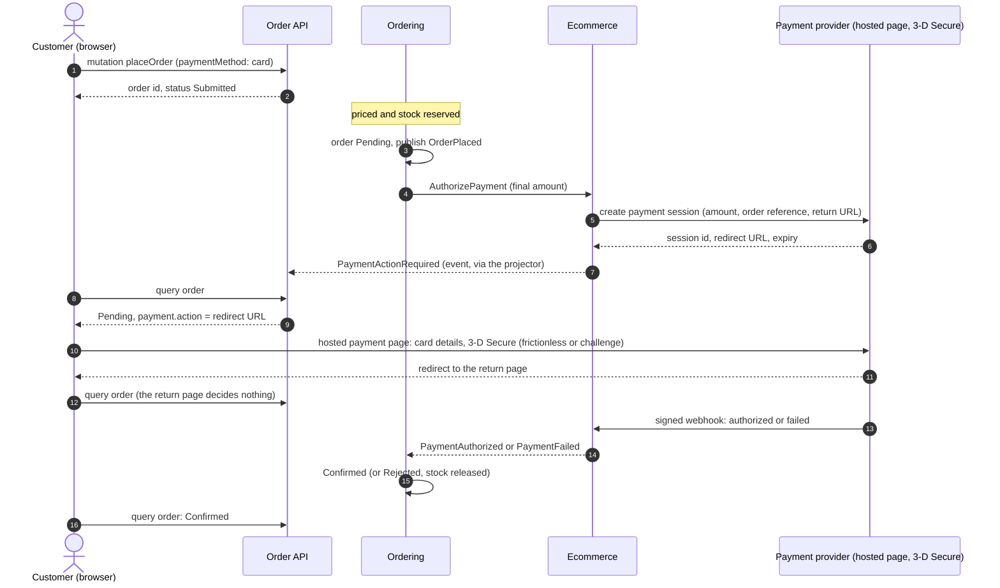
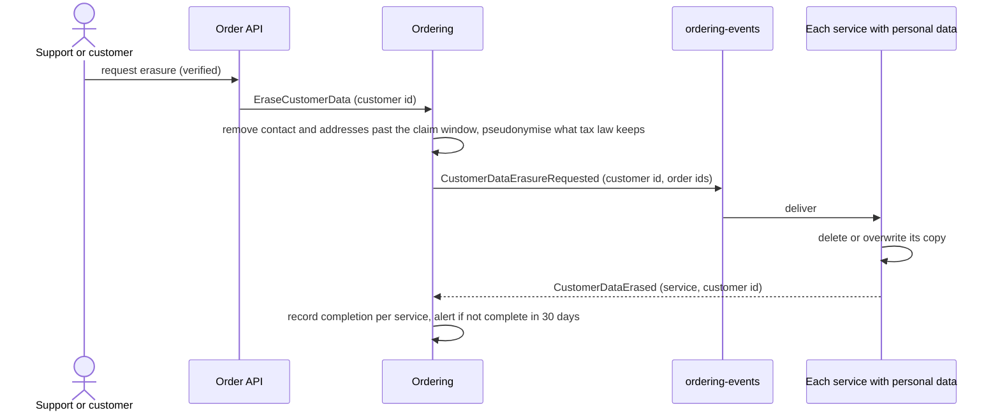

# 07 Data protection and compliance

The decisions are in [ADR-0014](../adr/0014-personal-data-and-payment-regulation.md). This document is
the working material a delivery team and a data protection officer need: where personal data is, who
receives it, how long it stays and how it is removed, and how a card payment with strong customer
authentication runs through the received-then-accepted flow.

**This is engineering input, not legal advice.** Retention periods and controller/processor roles are
proposals to confirm in the analysis phase with the data protection officer and the accountant.

## Personal data map

"Personal data" here means anything that identifies a customer directly (name, address, email, mobile
number, photo) or through an id we can resolve (customer id, order id). Order ids and customer ids are
**pseudonymous**: personal data, but not readable without the stores below.

### Stores

| Service | Store | Personal data | Purpose | Lawful basis | Retention and removal |
|---------|-------|---------------|---------|--------------|-----------------------|
| Ordering | Azure SQL `ordering` | Customer id, delivery address, contact details, lines, price, status history | Fulfil the order | Contract, 6(1)(b) | Address and contact removed after delivery plus the claim window (proposed 2 years). Order, lines and price pseudonymised and kept for the tax period |
| Order API | Table `OrderViews` | Customer id, items, destination, price, payment state, carrier, timeline | Show the order to the customer and support | Contract | Destination removed with Ordering's; view deleted when the order is pseudonymised. Rebuildable from events, so nothing exists only here |
| Ecommerce (ecommerce-integration-service) | Table `PaymentAttempts` | Order id, provider reference, amount, outcome. **No card data, no cardholder name** | Disputes, chargebacks, reconciliation | Contract, legal obligation | As the order |
| Inventory (inventory-integration-service) | Table reservations | Order id, SKUs. No person | Hold stock | Contract | 30 days after the order ends |
| Carriers (carrier-integration-service) | Table shipments; Blob labels and photos | Recipient name, address, phone (on the label and booking); proof-of-delivery photo | Book and follow the delivery; disputes | Contract | Labels 30 days after delivery; photos 90 days; booking data with the order's address |
| Notifications (notification-integration-service) | Table contacts and delivery reports | Email, mobile number, push handle, language; what was sent when | Tell the customer about their order | Contract | Contact deleted with the order's; delivery reports 90 days |
| Documents | Blob invoices and receipts | Name, billing address, VAT number for businesses | Tax | Legal obligation, 6(1)(c) | Tax period, then deleted by lifecycle rule. Not erased on request |
| Documents | Blob lobby (uploads before they are checked) | Whatever the uploaded file contains, for example a photo of a parcel at a door | Check and scan before storing | As for the file's final purpose | Deleted when the file is moved or rejected, at the latest after 24 hours |
| Identity (Entra External ID) | Tenant | Account email, name, sign-in log | Sign-in | Contract | Account deletion by the customer; sign-in logs by Entra's retention |
| All | Application Insights, Log Analytics | **None by rule**: ids, trace ids, codes | Operation | Legitimate interest, 6(1)(f) | 90 days |
| All | Service Bus queues, subscriptions, dead letters | What the message carries (below) | Transport | As the purpose of the message | TTL 7 days; dead letters purged after the incident, at most 14 days |
| Ordering | Azure SQL backups | Copy of the database | Recovery | Legitimate interest | Point-in-time 7 days. Erasure log replayed after any restore |

### Messages that carry personal data

Every other command and event carries ids, codes and amounts only.

| Message | Personal data | Who receives it | Why it needs it |
|---------|---------------|-----------------|-----------------|
| `PlaceOrder` (Order API → Ordering) | Delivery address, contact details | Ordering | It owns the order |
| `OrderSubmitted` | Destination, and contact details if the notification service is adopted | Order API projector, notification service | The view shows the destination; notifications need a contact |
| `OrderPlaced` | Destination in the summary | Order API projector, carrier service | The view; booking the carrier |
| `RequestShipment` | Recipient name, address, phone | Carrier service, then the carrier | Delivery |
| `PaymentActionRequired` | None (redirect URL of the provider's page, single use, short-lived) | Order API projector, notification service | Send the customer to pay |
| `EraseCustomerData`, `CustomerDataErasureRequested`, `CustomerDataErased` | Customer id and order ids | Every service holding personal data | Erasure |

A new field with personal data in a message adds a row here in the same pull request.

## Who else receives the data

| Party | Receives | Role (to confirm) | Where | Safeguard |
|-------|----------|-------------------|-------|-----------|
| Microsoft Azure (all resources) | Everything above | Processor | EU regions (West Europe); EU Data Boundary | Microsoft DPA |
| Azure Communication Services (email, SMS) | Email, mobile number, message text | Processor | Data location **Europe**, set at creation. SMS passes through telecom operators | Microsoft DPA. Message text minimal |
| Azure Notification Hubs → Apple APNs, Google FCM | Push handle, message text | Processor (Microsoft); Apple and Google as sub-processors | Outside the EU | EU–US Data Privacy Framework, standard contractual clauses. No address or product in the text |
| Payment provider | Amount, order reference, what the customer types on the hosted page | Processor for the payment; often independent controller for fraud screening and its regulatory duties | Provider's choice; prefer EU processing | Provider's DPA; it is PSD2 and PCI regulated itself |
| Carriers (ACS Courier, BoxNow, Skroutz Point and others) | Recipient name, address, phone, parcel data | Usually independent controllers for the delivery; processor for what they do on our instruction | Greece | Contract per carrier |
| 3PL or partner warehouses (for example Delatolas) | SKUs, quantities, and the address if they ship | Processor | Greece | DPA |
| E-invoicing provider or ERP (myDATA) | Invoice data | Processor | Greece | DPA; certified by AADE |

The register of processing activities (GDPR Art. 30) is built from these two tables.

## Card payment with strong customer authentication

The payment step after acceptance, as decided in ADR-0014. The customer is reading the order view
after the "received" answer anyway; the payment page is reached from there.

| Situation | What happens |
|-----------|--------------|
| Provider authorizes without asking (exemption, frictionless) | `PaymentAuthorized` directly; the view never shows an action |
| Customer closes the page during the challenge | The order stays `Pending`. The notification service sends "complete your payment"; the link asks the Order API for a fresh session. The `Pending` timeout ends the order and releases stock |
| Customer comes back from the provider but the webhook is late | The view shows "payment being confirmed". The reconciliation timer asks the provider if the webhook never arrives |
| Payment declined or authentication failed | `PaymentFailed` → `Rejected`, stock released. The customer can place the order again |
| Customer cancels while on the payment page | `CancelOrder` as usual; a late `PaymentAuthorized` is reversed ([02](02-order-lifecycle.md#what-happens-when-something-fails)) |
| Pay on delivery, bank transfer | No session and no SCA; `AuthorizePayment` answers per method |

**PCI DSS (SAQ A).** The platform never sees a card number. What remains for us: the page that sends
the customer to the provider is served over TLS with a strict Content Security Policy, its scripts are
listed and justified, and changes to it are detected (PCI DSS 4.0.1 eligibility for SAQ A). The webhook
is verified by signature ([ADR-0007](../adr/0007-security.md)).

## Erasure across services

- Handlers are idempotent like every other handler: erasing twice is harmless.
- An order still in progress (not delivered, open claim) is not erased; the request waits until it
  ends, and the customer is told.
- A late event that would recreate the data (for example a projector receiving an old `OrderPlaced`
  after erasure) is ignored, because the view keeps an "erased" marker with the order id and nothing else.

## Legal confirmations before go-live

- Retention periods: tax (with the accountant), claims window, photos.
- Controller or processor for each carrier, the 3PL and the payment provider; DPAs signed.
- Payment provider: hosted page or iframe fields, which exemptions it applies, webhook and reconciliation API, EU processing.
- Whether a DPIA is needed. Standard e-commerce usually does not need one; profiling, large-scale
  tracking or marketing would.
- Marketing messages stay out of scope; if they come, consent records and an unsubscribe flow come with them.
