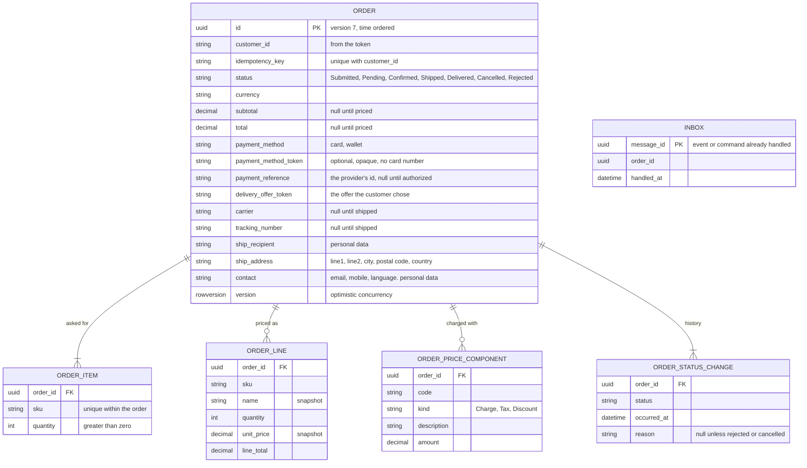
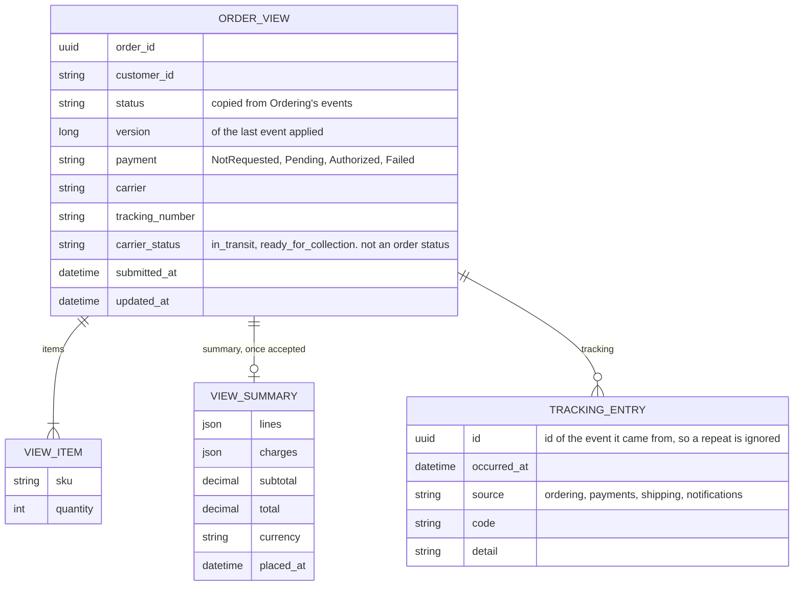

# 08 Data model

Every service owns its data and no service reads another's store
([ADR-0004](../adr/0004-data-ownership-and-storage.md)). There is therefore no single database
diagram of the platform, only one model per owner. The order id is the only key they share.

| Owner | Store | Holds |
|-------|-------|-------|
| Ordering | Azure SQL, schema `ordering` | The order of record: items, price, status, history |
| Order API | Azure Table storage | Order views: a copy for reading, rebuilt from events |
| Ecommerce, Inventory, Carriers, Notifications | Azure Table storage, one account per service | Provider references, reservations, shipments, contacts, inbox |
| Documents | Blob storage; Table storage | Files in the lobby and in a container per kind (images, labels, delivery photos, invoices); a file record per file token |
| Order API, files view | Azure Table storage | File token → container, path, order, owner, built from `DocumentStored` |

## Ordering: the order of record

This is the logical model of the `Order` aggregate
([Order.cs](../../src/Modules/Ordering/OrderProcessing.Ordering.Domain/Order.cs)). The skeleton keeps it
in memory; the tables below are what the EF Core mapping creates in package 1. Everything except
`INBOX` is loaded and saved as one aggregate, in one transaction.

- **Items and lines are both kept**, because they answer different questions: what was asked and what
  was agreed ([02](02-order-lifecycle.md#the-order-and-its-lines)).
- **The history is append-only.** A status is never overwritten without a row in `ORDER_STATUS_CHANGE`.
- **`INBOX` is in the same database** so that an order change and the record of the message that
  caused it commit together ([ADR-0012](../adr/0012-reliable-messaging-without-an-outbox.md)).
- **No product, customer or stock table.** Those belong to other systems; Ordering keeps a snapshot of
  what it needs and an id for the rest.
- **Personal data** is the recipient, the address and the contact. They are removed by the erasure
  workflow, and the rest of the order is kept for the tax period ([07](07-data-protection-and-compliance.md)).

## Order API: the order views

Two tables with the same row, keyed for the two ways an order is read
([ADR-0013](../adr/0013-cqrs-app-service.md)). The row is the `OrderView` of the GraphQL schema: the
nested parts (items, summary, tracking) are stored as JSON columns of the row.

| Table | PartitionKey | RowKey | Serves |
|-------|--------------|--------|--------|
| `OrdersByCustomer` | customer id | order id (time ordered, so newest first with a reversed key) | `myOrders`, and `order` for a customer. A customer can only read their own partition. |
| `OrdersById` | order id | `view` | `order` and lookups for the back office |

The view is never the source of truth. If it disagrees with Ordering, it is rebuilt from the events.

## Integration services

Each keeps a few small tables keyed by order id, so that "record the provider's answer and mark the
message handled" is one atomic batch in one partition.

| Service | Table | PartitionKey / RowKey | Holds |
|---------|-------|-----------------------|-------|
| Ecommerce | `Payments` | order id / attempt | Provider, provider payment id, amount, state |
| Inventory | `Reservations` | order id / source | One row per source allocation: items, quantities, expiry |
| Inventory | `InventorySources`, `RoutingRules` | source id; rule scope | Registry and routing configuration |
| Carriers | `Shipments` | order id / shipment | Carrier, tracking number, label reference, last carrier status |
| Notifications | `Contacts`, `SentLog` | order id / channel | Contact copy, what was sent, delivery report |
| Every service | `Inbox` | order id / message id | Messages already handled |

The details of each are in [06](06-integration-services.md). Table names that 06 does not give, and the
names of the two view tables, are proposals for the delivery team.
